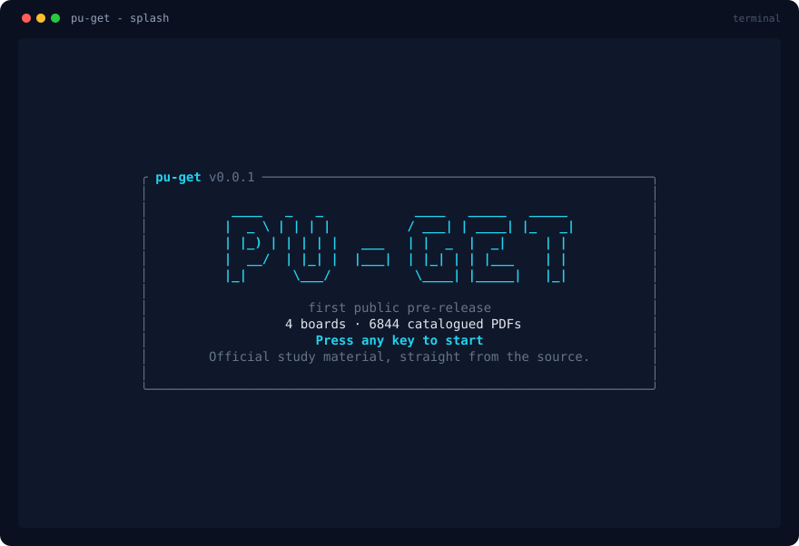
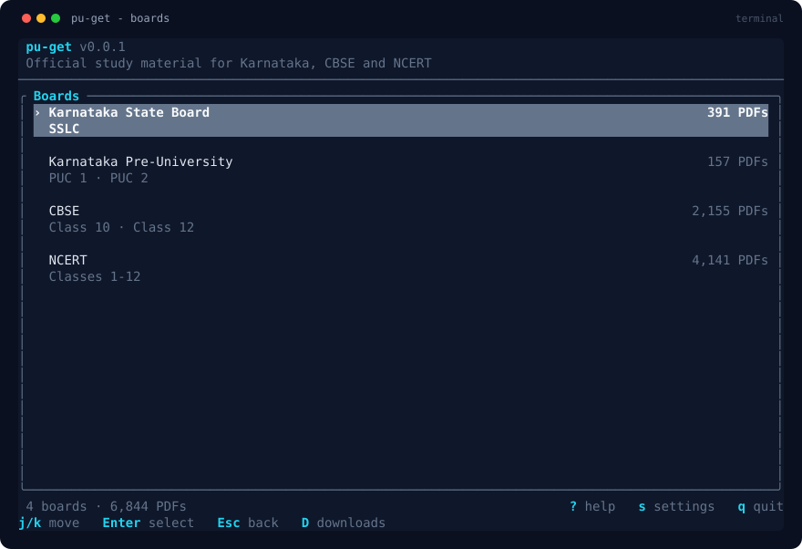
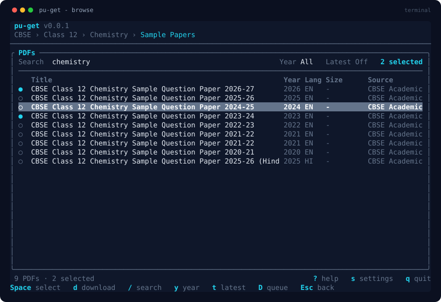
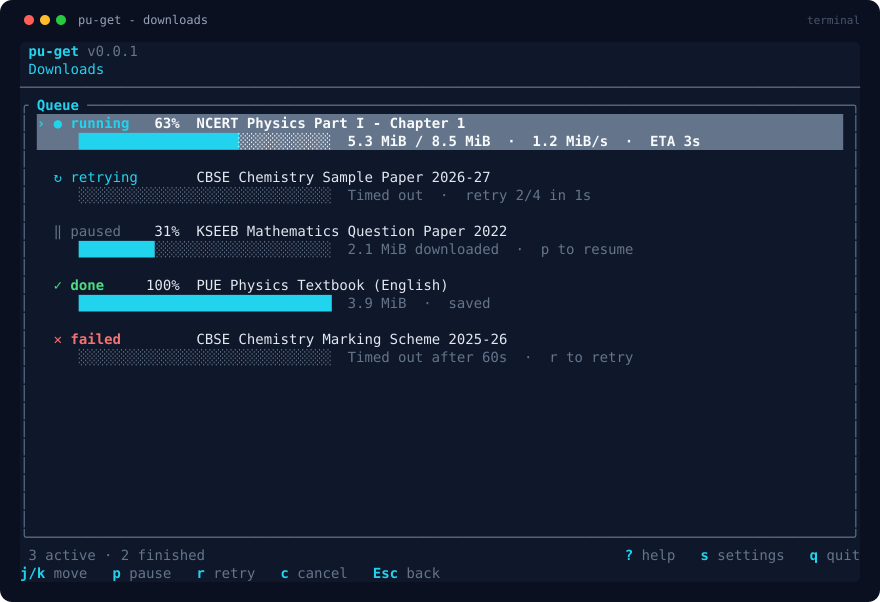
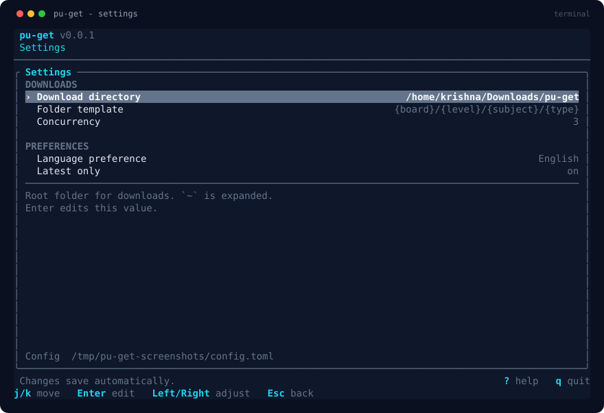
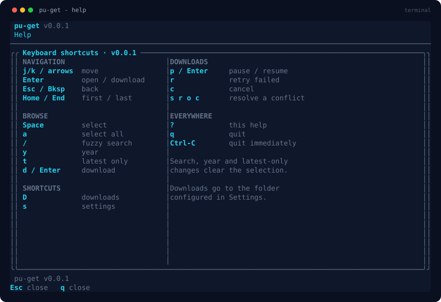

# pu-get

[](https://github.com/dumbramkrishna/pu-get/actions/workflows/ci.yml)
[](https://github.com/dumbramkrishna/pu-get/releases)
[](https://www.rust-lang.org)
[](LICENSE)

**Official study material, straight from the source.**

`pu-get` is a terminal browser and downloader for school and pre-university study
material. Pick a board, level, stream, subject and material type, then download the
exact PDF to a folder you choose. It supports Karnataka (SSLC, PUC 1, PUC 2) and
CBSE/NCERT (Classes 1-12).

The catalogs are built by crawling official board portals. URLs are never typed by
hand, and rehosted paid or copyrighted guidebooks are deliberately excluded.

New to the project? Start with the [documentation index](docs/README.md) and
[CONTRIBUTING.md](CONTRIBUTING.md).

> **Status:** v0.0.1, the first public pre-release. The embedded catalogs are a
> point-in-time snapshot (2026-11-21); official portals move files. Use
> `pu-get verify` to check links and `pu-get update` or `pu-get crawl` to refresh a
> catalog.

## Contents

- [Why pu-get](#why-pu-get)
- [Screenshots](#screenshots)
- [Supported boards](#supported-boards)
- [Material types](#material-types)
- [Install](#install)
- [Quick start](#quick-start)
- [Keyboard shortcuts](#keyboard-shortcuts)
- [Command-line usage](#command-line-usage)
- [Configuration](#configuration)
- [Catalogs and updates](#catalogs-and-updates)
- [Adding a board or resolver](#adding-a-board-or-resolver)
- [Documentation](#documentation)
- [Building and testing](#building-and-testing)
- [Contributing](#contributing)
- [Disclaimer](#disclaimer)
- [License](#license)

## Why pu-get

- **Official sources only.** Resolvers read official index pages; catalogs never
  contain hand-written PDF links.
- **Board-aware browsing.** Levels, streams, subjects, years and languages are
  derived from the catalog, so new boards appear without UI changes.
- **A real TUI.** Fuzzy search, year filtering, latest-only mode, multi-select,
  progress bars, pause/resume, retries and conflict handling.
- **Scriptable too.** `list` and `get` work without the TUI, including JSON output
  and dry runs.
- **Careful downloads.** Streaming writes go to `.part` files, PDFs are checked for
  the `%PDF` marker and content type, resume uses `Range`, and files are published
  atomically.
- **Your config, your folders.** Configurable download root, folder template,
  language preference and concurrency.

## Screenshots

The screenshots below are rendered from the real TUI at 100×30 by
`cargo run --example screenshots`.

### Splash



### Pick a board



### Browsing CBSE sample papers



### Download queue



### Settings



### Help



## Supported boards

| Board | Catalog id | Levels | Snapshot entries | Notes |
|---|---|---:|---:|---|
| Karnataka State Board | `kseeb` | SSLC (Class 10) | 391 | SSLC question papers and model answers |
| Karnataka Pre-University | `pue` | PUC 1, PUC 2 | 157 | Science, Commerce and Arts, plus common subjects |
| CBSE | `cbse` | Classes 10 and 12 | 2,155 | Sample question papers and marking schemes |
| NCERT | `ncert` | Classes 1-12 | 4,141 | Textbook chapters |

More boards can be added through the source registry. Curated board order is
Karnataka first, then CBSE/NCERT, then additional catalogs alphabetically.

### Source status

Verified sources: **KSEAB**, **PUE Karnataka**, **CBSE Academic** and **NCERT**.
The registry also contains unverified official sources (the KSEAB model-paper and
syllabus index, KTBS, DSERT, NIOS, DIKSHA, e-Pathshala, SWAYAM and NPTEL).
Unverified sources are skipped by `crawl` unless selected explicitly or
`--include-unverified` is passed.

Two source limitations are documented rather than worked around with invented URLs:

- `pue.karnataka.gov.in` currently presents an incomplete TLS certificate chain.
  The checked-in PUE catalog was generated from the saved official page using the
  PUE resolver; `pu-get crawl` reports the certificate error until the portal's
  chain is fixed.
- Recent KSEAB question-paper pages trigger ASP.NET postbacks instead of exposing
  stable PDF GET URLs. Those pages are reported in the crawl report; only direct
  PDFs are catalogued.

## Material types

| Catalog value | Label in the TUI |
|---|---|
| `textbook` | Textbook |
| `model_paper` | Model Papers |
| `previous_year_paper` | Previous Year Papers |
| `sample_paper` | Sample Papers |
| `marking_scheme` | Marking Scheme |
| `syllabus` | Syllabus |

Availability depends on what each official portal publishes.

## Install

### One-line installer (Linux and macOS)

```sh
curl -fsSL https://raw.githubusercontent.com/dumbramkrishna/pu-get/main/install.sh | sh
```

The script resolves the newest published release (including pre-releases),
downloads the archive for your OS/architecture, verifies it against the
release's `SHA256SUMS.txt`, and installs to `~/.local/bin`. It never uses
`sudo`, and prints a PATH hint when the directory is not on your path.

Choose a version or directory explicitly:

```sh
curl -fsSL https://raw.githubusercontent.com/dumbramkrishna/pu-get/main/install.sh \
  | sh -s -- --version v0.0.1 --dir "$HOME/.local/bin"
```

Use `--dry-run` to see the archive and destination without installing, and
`--force` to reinstall. The environment equivalents are `PU_GET_VERSION` and
`PU_GET_INSTALL_DIR`. Review [`install.sh`](install.sh) before piping it to a
shell if you prefer.

### One-line installer (Windows)

```powershell
irm https://raw.githubusercontent.com/dumbramkrishna/pu-get/main/install.ps1 | iex
```

By default this installs to `%LOCALAPPDATA%\Programs\pu-get\bin` and prints the
command to add it to your user `PATH`. To add it in the same run:

```powershell
irm https://raw.githubusercontent.com/dumbramkrishna/pu-get/main/install.ps1 -OutFile install.ps1
.\install.ps1 -AddToPath
Remove-Item install.ps1
```

`-Version`, `-InstallDir`, `-Force` and `-DryRun` are also supported. Both
installers require HTTPS for release downloads.

### Prebuilt binaries

Download the archive for your platform from
[GitHub Releases](https://github.com/dumbramkrishna/pu-get/releases). The release
workflow builds:

- Linux `x86_64-unknown-linux-gnu`
- macOS `aarch64-apple-darwin` and `x86_64-apple-darwin`
- Windows `x86_64-pc-windows-msvc`

To build downloadable unsigned archives before a tag exists, run the
[**Binaries**](https://github.com/dumbramkrishna/pu-get/actions/workflows/binaries.yml)
workflow manually from the Actions tab. It produces the same archives plus
`SHA256SUMS.txt` without publishing a release.

macOS binaries are unsigned, and Windows binaries are unsigned; the operating
system may show a warning the first time you run a downloaded build. Use your OS's
normal “open anyway” flow, or build from source if you prefer.

### With Cargo

```sh
cargo install --git https://github.com/dumbramkrishna/pu-get --locked
```

Or from a clone:

```sh
git clone https://github.com/dumbramkrishna/pu-get
cd pu-get
cargo install --path . --locked
```

### Build from source

```sh
git clone https://github.com/dumbramkrishna/pu-get
cd pu-get
cargo build --release
# binary: target/release/pu-get
```

Requirements: Rust **1.88 or newer** (stable recommended). pu-get uses rustls, so
does not need OpenSSL. A normal platform linker is required.

## Quick start

```sh
pu-get
pu-get --version   # pu-get 0.0.1
```

`pu-get browse` (alias: `pu-get tui`) opens the same UI explicitly. The flow is:

1. Splash screen.
2. Board (Karnataka State Board, Pre-University, CBSE, NCERT, ...).
3. Level (SSLC, PUC 1, PUC 2, Class 1-12).
4. Stream, when the board and level use streams.
5. Subject.
6. Material type.
7. PDF list with search, year filtering and multi-select.
8. Download queue.
9. Settings (`s`) and help (`?`) from anywhere.

Use `Space` to select several PDFs and `d` or `Enter` to download. Downloads run in
the background while you keep browsing; press `D` to return to the queue.

The UI is designed for **80×24 or larger**, adapts to resizes, and honours
`NO_COLOR` and `--no-color`. If the terminal is too small it shows a clear message
instead of a broken layout.

## Keyboard shortcuts

### Navigation

| Key | Action |
|---|---|
| `j` / `k` or Down / Up | Move |
| `Enter` | Open the row, or download the current/selected PDFs |
| `Esc` / `Backspace` | Go back; cancel a search or picker |
| `Home` / `End` | First / last row |
| `PageUp` / `PageDown` | Move a page at a time |
| `?` | Toggle the help overlay |
| `s` | Settings |
| `D` | Download queue |
| `q` | Quit (or close the help overlay) |
| `Ctrl-C` | Quit immediately |

### Browsing PDFs

| Key | Action |
|---|---|
| `/` | Fuzzy search over title, subject, source, level and board |
| `Space` | Add/remove the current PDF from the selection |
| `a` | Select all visible PDFs, or clear if all are selected |
| `d` / `Enter` | Download selected PDFs (or the current row) |
| `y` | Year filter |
| `t` | Toggle latest-only (on by default) |
| `Esc` | Back to material type |

Search, year and latest-only changes clear the current selection to avoid
downloading hidden rows. `latest only` hides older editions; the year picker
ignores latest-only so you can opt into an older paper.

### Queue

| Key | Action |
|---|---|
| `p` / `Enter` | Pause or resume the selected download |
| `r` | Retry a failed download |
| `c` | Cancel the selected download |
| `Esc` | Back to the browser |

If a destination already exists, an overlay asks you to **skip** (`s`), **rename**
(`r`), **overwrite** (`o`) or **cancel** (`c`). No file is overwritten without an
explicit decision.

## Command-line usage

Run `pu-get --help` or `pu-get <command> --help` for the complete flag list.

### List catalog entries

```sh
pu-get list --board kseeb --level SSLC --type previous_year_paper --latest
pu-get list --board cbse --level 12 --subject Chemistry --type sample_paper --year 2026
pu-get list --search physics --language en --limit 20
pu-get list --board ncert --level 12 --json
```

`--level` accepts friendly aliases such as `SSLC`, `Class 10`, `PUC 1`, `Class 11`
and `12`; alias handling is board-aware.

### Download

```sh
pu-get get --board ncert --level 12 --subject Physics --type textbook
pu-get get --board cbse --level 12 --subject Chemistry --type sample_paper --latest
pu-get get --board kseeb --level SSLC --type previous_year_paper --out ./papers
pu-get get --board ncert --level 11 --subject Chemistry --dry-run
```

Useful options:

- `--out DIR` overrides the configured download root for this run.
- `--latest` keeps the newest entry per subject/type/language group.
- `--limit N` caps the number of files.
- `--conflict ask|skip|rename|overwrite` controls existing files. The default is
  `ask`; when stdin is not a terminal, `ask` becomes `rename` and a note is printed.
- `--concurrency N` overrides the configured parallelism (1-16).
- `--yes` skips the interactive confirmation for multi-file runs. It does not mean
  "overwrite": conflicts still follow `--conflict`.
- `--dry-run` prints the resolved destination paths and exits.

The destination is built from the download root and the folder template, then the
sanitised PDF title is appended. The default layout is:

```text
<download-dir>/{board}/{level}/{subject}/{type}/<title>.pdf
```

### Configuration

```sh
pu-get config path
pu-get config show
pu-get config show --json
pu-get config list
pu-get config get concurrency
pu-get config set download_dir '~/Study'
pu-get config set folder_template '{board_id}/{level}/{subject}/{type}/{language}'
pu-get config set language kn
pu-get config set concurrency 4
pu-get config set latest_only false
pu-get config set update_url 'https://raw.githubusercontent.com/OWNER/REPO/main/manifest.toml'
```

`pu-get config set` validates before writing and persists atomically. Empty strings
clear optional values such as `update_url`.

### Verify catalog URLs

```sh
pu-get verify --board ncert --level 12 --limit 20 --concurrency 4
pu-get verify --board cbse --subject Chemistry --report verify-report.txt
```

`verify` prefers `HEAD`, falls back to a one-byte ranged `GET`, and rejects HTML
pages served with `200 OK`. It checks the PDF content type and magic bytes where
the server allows it.

### Crawl official sources

```sh
pu-get crawl
pu-get crawl --dry-run
pu-get crawl --source kseab-sslc-question-papers --no-validate
pu-get crawl --include-unverified --out target/catalogs
```

`crawl` runs the registry (verified sources by default), HEAD-validates every
discovered URL, drops failures, writes `sources/generated/<board>.toml`, and writes
`sources/generated/crawl-report.txt`. If every source for a board fails, the
existing catalog is left untouched. Reports are intentionally treated as runtime
artifacts and ignored by git.

Crawling every source is network-heavy; the NCERT chapter check is the slow part.
Use `--source` while developing a resolver.

### Update an installed catalog

```sh
pu-get update --check --remote https://example.com/manifest.toml
pu-get update --remote https://example.com/manifest.toml
pu-get update --force
```

The manifest can be TOML or JSON with `schema_version = 1`, `catalog_version`,
`catalog_url` and a lowercase SHA-256 `sha256`. The catalog itself may be a
single-board TOML file or JSON (one board, an array, or `{ "boards": [...] }`).
`update` validates the checksum and catalog, then installs it atomically under the
user catalog directory so it overrides embedded entries. Use `--remote` or set
`update_url` first. `--force` reinstalls even when the version is unchanged. See
[sources/schema.md](sources/schema.md).

## Configuration

### File locations

| Platform | Configuration | Catalogs | Cache/state |
|---|---|---|---|
| Linux | `$XDG_CONFIG_HOME/pu-get/config.toml` or `~/.config/pu-get/config.toml` | `~/.config/pu-get/catalogs/` | `$XDG_CACHE_HOME/pu-get/` or `~/.cache/pu-get/` |
| macOS | `~/Library/Application Support/pu-get/config.toml` | `~/Library/Application Support/pu-get/catalogs/` | `~/Library/Caches/pu-get/` |
| Windows | `%APPDATA%\pu-get\config.toml` | `%APPDATA%\pu-get\catalogs\` | `%LOCALAPPDATA%\pu-get\` |

- `--config PATH` uses a different configuration file. User catalogs live next to
  it; the cache still uses the platform cache root unless overridden.
- `PU_GET_CONFIG` is the environment equivalent of `--config`.
- `PU_GET_CACHE_DIR` overrides the cache/state directory (useful for portable
  installs and tests).

### Example configuration

```toml
schema_version = 1
download_dir = "~/Downloads/pu-get"
folder_template = "{board}/{level}/{subject}/{type}"
language = "en"                 # en | kn | hi | ur
concurrency = 3                 # 1-16
latest_only = true
request_timeout_secs = 60       # 1-600
retries = 3                     # 0-10

# Optional: consulted by `pu-get update` when --remote is omitted.
# update_url = "https://raw.githubusercontent.com/OWNER/REPO/main/manifest.toml"
```

`language` is a **preference**, not a filter: matching-language files move to the
top of the list while other languages remain available. The `latest_only` value is
the default for new TUI browser sessions. A concurrency change takes effect the next
time `pu-get` starts.

### Folder template placeholders

| Placeholder | Value |
|---|---|
| `{board}` | Board display name (`Karnataka State Board`) |
| `{board_id}` | Board id (`kseeb`) |
| `{level}` | Level as stored in the catalog (`SSLC`, `PUC 2`, `12`) |
| `{stream}` | Stream, or `general` when absent |
| `{subject}` | Subject name |
| `{type}` | Material type id (`sample_paper`, ...) |
| `{year}` | Year, or `undated` when absent |
| `{language}` | Language code (`en`, `kn`, `hi`, `ur`) |
| `{source}` | Official source label (`KSEAB`, `NCERT`, ...) |
| `{title}` | Sanitised title (the filename is also based on the title) |

Templates are validated: absolute paths, `..` traversal and unknown placeholders are
rejected.

## Catalogs and updates

### How catalogs are layered

1. **Embedded catalogs** — `sources/generated/*.toml` compiled into the binary with
   `rust-embed`.
2. **User catalogs** — `.toml` or `.json` files in the user catalog directory,
   loaded in filename order and merged over the embedded catalogs. Entries with the
   same URL are replaced; new boards are appended.
3. **Remote catalogs** — installed by `pu-get update` into the same user catalog
   directory.

The catalog schema and update manifest are documented in
[`sources/schema.md`](sources/schema.md). Entries with an empty URL are skipped.

### Adding user catalogs manually

Create `<config-dir>/pu-get/catalogs/my-board.toml`:

```toml
[board]
id = "my-board"
name = "My Board"

[[entries]]
level = "10"
subject = "Mathematics"
type = "previous_year_paper"
title = "Mathematics Paper 2025"
language = "en"
year = 2025
url = "https://official.example.edu/papers/maths-2025.pdf"
source = "My Board"
page = "https://official.example.edu/papers/"
```

User catalogs are for official or openly licensed links only. Do not add paid
guidebooks or files you do not have the right to distribute.

## Adding a board or resolver

`pu-get` is designed so that a new board does not require any UI changes. The full
walkthrough — registry schema, resolver code, fixtures, crawl and verification — is
in **[docs/ADDING_SOURCES.md](docs/ADDING_SOURCES.md)**. The short version:

1. **Pick an official source.** Boards, government bodies or openly licensed
   publishers only. Never add a rehosting site or a hand-written PDF URL.
2. **Try `generic_index` first.** If the portal is a simple index of direct PDF
   links, add a `[[source]]` entry to
   [`sources/registry.toml`](sources/registry.toml) with
   `resolver = "generic_index"` and crawl it. No Rust required.
3. **Write a resolver only when the markup demands it.** Add a module under
   `src/resolver/`, a `ResolverKind` variant and dispatch arm, and the board's
   display name.
4. **Test with saved fixtures.** Put the official HTML under
   `tests/fixtures/resolvers/` and add a parser test to
   `tests/resolvers_fixtures.rs`. Tests must never use the live network.
5. **Keep the source `unverified`** until you have confirmed the index and the
   files, then run `pu-get crawl` to regenerate the catalog.
6. **Open a source request first** for a new board so scope, ownership and licence
   can be checked before you write code.

Never invent a URL or disable TLS verification to make a source work. If an
official portal serves an incomplete certificate chain, document it and keep the
previous catalog. The registry and catalog formats are documented in
[`sources/schema.md`](sources/schema.md).

## Documentation

The README covers installation and daily use. Contributor and design guides live
under [`docs/`](docs/README.md):

| Guide | What it covers |
|---|---|
| [Documentation index](docs/README.md) | Entry point for all guides |
| [Architecture](docs/ARCHITECTURE.md) | Modules, data flow, invariants and the download lifecycle |
| [Adding sources](docs/ADDING_SOURCES.md) | Registry rules, `generic_index`, custom resolvers, fixtures, crawl and verification |
| [Commit messages](docs/COMMITS.md) | Type dictionary, scopes, examples and how to add a type |
| [Development](docs/DEVELOPMENT.md) | Toolchain, commands, testing, debugging and local overrides |
| [Releasing](docs/RELEASING.md) | Versioning, release checklist, tags and artifacts |
| [Screenshots](docs/screenshots/README.md) | How the README images are generated |
| [Catalog schema](sources/schema.md) | Catalog and update-manifest formats |

## Building and testing

```sh
cargo fmt --all -- --check
cargo clippy --locked --all-targets -- -D warnings
cargo test --locked --all-targets
CARGO_TARGET_DIR=target/msrv188 cargo +1.88.0 check --locked --all-targets
cargo build --release --locked
```

The test suite covers catalog parsing, filtering, filename sanitising, path
templating, year handling, the download manager against a local mock HTTP server,
resolver fixtures, update checksums, and the main TUI screens at 80×24 via
`ratatui::backend::TestBackend`. Tests never contact the live network.

See **[docs/DEVELOPMENT.md](docs/DEVELOPMENT.md)** for toolchain details,
debugging tips, local config isolation and the screenshot workflow. Regenerate the
README screenshots with:

```sh
cargo run --example screenshots
```

Release builds are produced by
[`.github/workflows/release.yml`](.github/workflows/release.yml) when a tag such as
`v0.0.1` is pushed. The full checklist is in
[docs/RELEASING.md](docs/RELEASING.md). For a dry run without a tag, use the
[**Binaries**](.github/workflows/binaries.yml) workflow.

## Contributing

Contributions of code, documentation, tests, fixtures and careful source reports
are welcome. Start with **[CONTRIBUTING.md](CONTRIBUTING.md)**; the documentation
index is **[docs/README.md](docs/README.md)**.

Pull-request labels such as `tui`, `source`, `catalog`, `downloads` and `ci` are
applied automatically from [`.github/labeler.yml`](.github/labeler.yml) based on
the changed paths. Issue forms apply their area and triage labels on creation.

Commit messages and PR titles are checked against the project dictionary in
[`.github/commit-types.json`](.github/commit-types.json). Read
[docs/COMMITS.md](docs/COMMITS.md) before opening a pull request; adding a new
type starts with a dictionary entry and a docs update, not code.

- **Adding a board or fixing a source?** Read
  [docs/ADDING_SOURCES.md](docs/ADDING_SOURCES.md) and open a
  [source request](https://github.com/dumbramkrishna/pu-get/issues/new?template=source_request.yml)
  before writing a resolver.
- **Found a bug?** Use the
  [bug form](https://github.com/dumbramkrishna/pu-get/issues/new?template=bug_report.yml)
  with the version, OS/terminal, reproduction steps and logs.
- **Have an idea?** Use the
  [feature form](https://github.com/dumbramkrishna/pu-get/issues/new?template=feature_request.yml).
- **Security issue?** Report it privately following [SECURITY.md](SECURITY.md);
  do not open a public issue.
- **Pull requests** should follow the
  [PR template](.github/PULL_REQUEST_TEMPLATE.md), pass the local quality gate,
  and include a fixture and test for new parsers.

Participation is covered by [CODE_OF_CONDUCT.md](CODE_OF_CONDUCT.md). The source
policy is simple: official boards/government bodies or openly licensed material
only, and PDF URLs are discovered, never hand-written.

If you find a source that has moved, a broken catalog entry, or a portal that
should be removed, include the official page URL and the resolver output in the
report.

## Disclaimer

`pu-get` is an unofficial index and downloader. It does not host, mirror or sell any
document. All textbooks, question papers, model papers, sample papers, marking
schemes, syllabi and other files belong to their respective boards, publishers and
copyright holders.

The project links only to files published by official boards or government bodies,
or material published under an open licence. It is not affiliated with, endorsed by
or sponsored by the Karnataka Government, KSEAB, PUE Karnataka, CBSE, NCERT or any
other board or publisher.

Official portals can change URLs, remove documents, require postbacks or impose
terms of use. Always confirm exam dates, syllabi and official information with the
relevant board. Downloads are subject to the source's terms and applicable
copyright law. The software is provided "as is", without warranty of any kind.

If you are a rights holder and believe a link should not be included, please open an
issue with the URL and the source page so it can be reviewed and removed.

## License

MIT. See [LICENSE](LICENSE).
