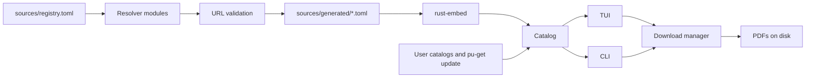

# Architecture

pu-get is a Rust library plus a thin binary. The library contains the TUI, the
catalog layer, official-source resolvers and the download engine, so integration
tests can exercise everything without spawning a process.

## Design goals

1. **Official sources only.** Resolvers discover links from official index pages.
   Catalog entries are never typed by hand.
2. **Offline, deterministic tests.** Network access is confined to the live
   `resolve`, `crawl`, `verify` and `update` paths. Tests use saved HTML and local
   wiremock servers.
3. **No blocking in the UI.** Downloads run in a Tokio task and communicate with
   the UI over a bounded event channel.
4. **Pure rendering.** `ui::draw` and every screen module take `&App`; rendering
   never performs I/O or mutates app state.
5. **One model for both interfaces.** The TUI and `list`/`get` commands share the
   same catalog and filter code.
6. **Safe filesystem behavior.** Destinations are sanitised, `.part` files are
   validated, and publishing never silently overwrites a file.

## System map



## Module map

| Module | Responsibility |
|---|---|
| `src/main.rs` | Parse arguments, initialise logging, report fatal errors |
| `src/cli.rs` | Clap surface and the non-interactive commands (`list`, `get`, `config`, `crawl`, `verify`, `update`) |
| `src/app/` | TUI state machine, key handling, terminal lifecycle, manager event loop |
| `src/ui/` | Pure rendering for splash, boards, menus, PDF table, queue, settings and help |
| `src/catalog/` | Typed catalog model, embedded/user loading and merge rules, filtering and latest-only selection |
| `src/resolver/` | Registry parsing, source dispatch and one module per official portal |
| `src/download/` | Streaming manager, job queue, progress, candidate paths and PDF validation |
| `src/config.rs` | Platform paths, TOML config, validation and atomic persistence |
| `src/http.rs` | Shared reqwest client and error-chain formatting |
| `src/verify.rs` | HEAD/range-GET URL validation and reports |
| `src/error.rs` | Domain error enums (`ConfigError`, `CatalogError`, `DownloadError`, `ResolverError`, `PathError`) |

## Runtime flows

### TUI

1. `pu-get::app::run` checks that stdin/stdout are terminals, loads the catalog and
   starts the download manager.
2. `App::new` starts on the splash screen. `app::events` translates crossterm
   events into state transitions.
3. Selection screens derive their options from the catalog:
   - boards in curated order;
   - levels from the selected board;
   - streams from the selected level;
   - subjects from board/level/stream;
   - material types from board/level/stream/subject.
4. The PDF list uses the shared `Filter`, then applies fuzzy search and language
   preference ordering.
5. Pressing `d`/`Enter` builds `DownloadSpec`s and sends them to the manager.
   The UI stays responsive because it only receives `DownloadEvent`s.
6. `Esc`/`Backspace` navigate back. Settings and help are overlays/screens on top
   of the same state.

The chrome is deliberately split into a header, a single rounded body panel, a
status line and a contextual footer. Rendering functions receive only `&App`.

### `pu-get get`

`catalog::Filter` produces entries, `DownloadSpec::from_entry` resolves destinations,
and the same download manager streams files. Interactive conflict prompts are
handled inline; when stdin is not a terminal, `ask` becomes `rename`.

### `pu-get crawl`

1. `sources/registry.toml` is parsed and validated.
2. Verified sources are selected by default. Explicit `--source` ids are always
   selected; `--include-unverified` selects the rest.
3. Each resolver fetches official pages and returns `Resolved { entries, notes, pages_fetched }`.
4. URLs are HEAD-validated (with a ranged GET fallback).
5. Failing entries are dropped, notes are collected, and one
   `sources/generated/<board>.toml` file is written per board.
6. `sources/generated/crawl-report.txt` records counts, notes and failures.
7. The generated TOMLs are compiled into the next binary by `rust-embed`.

If every source for a board fails, the existing generated catalog for that board is
left alone rather than replaced with an empty file.

### `pu-get update`

A manifest (TOML or JSON) provides a catalog version, URL and SHA-256. The payload
must be a valid catalog. After checksum and schema validation it is written
atomically to the user catalog directory and overrides embedded entries.

## Catalog model

A board catalog is one `[board]` plus `[[entries]]` (see
[`sources/schema.md`](../sources/schema.md)). Loading order:

1. embedded `sources/generated/*.toml`, sorted by filename;
2. user files in `<config-dir>/pu-get/catalogs/*.toml|*.json`, sorted by filename.

Entries with the same URL are replaced by the later entry. Empty URLs are skipped.
An empty URL is useful for resolver placeholders but never appears in a shipped
catalog.

Level matching is board-aware:

- `SSLC` and `Class 10` are equivalent for KSEEB;
- `PUC 1` and `11`, and `PUC 2` and `12`, are equivalent for PUE;
- CBSE and NCERT use numeric classes.

An entry without a stream is treated as common to every stream when a stream is
selected. Latest-only groups by board, level, stream, subject, type and language,
then keeps the newest dated entry. Undated entries survive.

## Download lifecycle

1. Build a destination from the catalog title and the folder template. Path
   components and filenames are sanitised; traversal and absolute templates are
   rejected.
2. Preflight:
   - same-size existing file → skip;
   - existing file and `ask` → emit `Conflict` and wait;
   - rename/overwrite/skip policy otherwise.
3. Download to `<destination>.part` with streaming writes.
4. Resume with a `Range` request when a `.part` exists.
5. Retry transient errors with exponential backoff.
6. Validate the response content type and the `%PDF` magic bytes.
7. Publish with a hard link (or a platform fallback) so a complete destination is
   never partially visible.
8. Emit `Progress`, `Retrying`, `Paused`, `Completed`, `Skipped`, `Failed` or
   `Cancelled` events.

The manager runs a bounded number of jobs (default 3, configurable 1-16). UI
commands are `pause`, `resume`, `cancel`, `retry`, `resolve_conflict` and
`shutdown`; all go through the same command channel.

## Resolver contract

Each source has a `ResolverKind` and a module implementing:

```rust
pub async fn resolve(
    client: &reqwest::Client,
    source: &SourceDefinition,
) -> ResolverResult<Resolved>;
```

Parsers must be separate pure functions so they can be tested with
`tests/fixtures/resolvers/*.html`. Resolvers must:

- stay on the official host unless there is a documented reason to follow a
  related official domain;
- emit only absolute HTTP(S) URLs;
- avoid fabricating URLs for postback-only pages;
- report missing/removed pages as notes, not invented entries;
- deduplicate by URL.

See [Adding sources](ADDING_SOURCES.md) for the full walkthrough and a code
skeleton.

## Error and logging strategy

Domain modules return precise `thiserror` enums. The binary converts them to
`anyhow` at the boundary and prints `pu-get: error: ...`. Tracing goes to stderr
for CLI commands; logging is disabled while the TUI owns the alternate screen.
Fatal TUI errors restore the terminal through a guard and panic hook.

## Testing strategy

| Layer | Test style |
|---|---|
| Catalog | TOML/JSON parsing, merge rules, filtering, latest-only, aliases |
| Paths | Sanitisation, traversal rejection, templates, collision numbering |
| Download | Local wiremock HTTP server: streaming, resume, retries, conflicts, PDF validation |
| Resolvers | Saved official HTML fixtures; parser output, years, languages, dedupe |
| Verify | Local wiremock: HEAD, range fallback, HTML rejection |
| Update | Local manifest/catalog server, checksum and atomic install |
| TUI | `ratatui::backend::TestBackend` at 80×24; pure render smoke tests |
| Screenshots | `examples/screenshots.rs` renders 100×30 SVGs from the real state/render path |

No test contacts the public internet. MSRV is **1.88**, checked in CI.

## Security invariants

- rustls is used with normal verification. TLS verification is never disabled.
- Catalog URLs must be absolute HTTP(S) URLs.
- Folder templates reject absolute paths, `..`, and unknown placeholders.
- Filenames are sanitised for Windows-reserved names and path separators.
- Downloads are validated as PDFs before publication.
- Remote catalogs are checksum-verified before parsing.
- TUI rendering does not execute catalog content; control characters are
  sanitised by the path layer where relevant.

See [SECURITY.md](../SECURITY.md) for reporting vulnerabilities.
